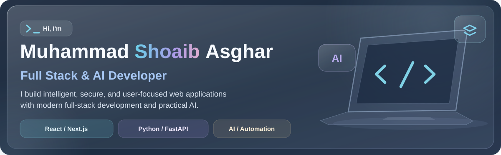
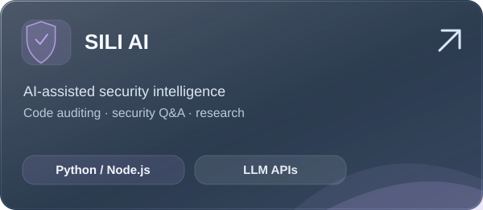
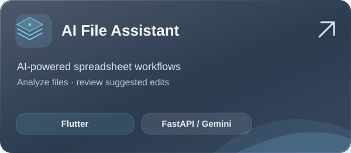
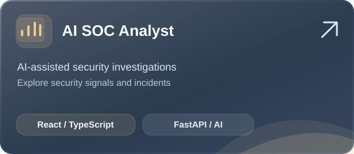
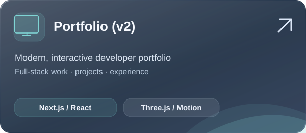

  

   

  
  &nbsp;
  
  &nbsp;
  

   
   

  

### 🧰 Tech Stack

Tools I use to build polished interfaces, reliable APIs, and intelligent software.

  

 

### 📂 Featured Projects

<table>
  <tr>
    <td width="50%" valign="top">
      
      
Self-hosted AI-assisted security tools with code auditing and security research workflows.

      <a href="https://github.com/Shoaib1515?tab=repositories"><strong>Explore repositories →</strong></a>
    </td>
    <td width="50%" valign="top">
      
      
Work with spreadsheets using natural language, then validate and approve proposed AI edits.

      <a href="https://github.com/Shoaib1515/ai-file-assistant"><strong>View source →</strong></a>
    </td>
  </tr>
  <tr>
    <td width="50%" valign="top">
      
      
Full-stack AI-assisted security investigation workflows connecting a React UI with Python APIs.

      <a href="https://github.com/Shoaib1515/ai-soc-analyst"><strong>View source →</strong></a>
    </td>
    <td width="50%" valign="top">
      
      
My personal developer portfolio built with Next.js, React, Three.js, and Framer Motion.

      <a href="https://portfolio-shoaib22.vercel.app/"><strong>View live portfolio →</strong></a>
    </td>
  </tr>
</table>

### ✨ What I Build

- **Full-stack products:** responsive UIs, backend APIs, data flows, and clean application architecture.
- **Practical AI features:** natural language experiences, structured LLM outputs, and useful automation.
- **Thoughtful security:** validation, clear permissions, human review, and secure-by-design development.

> **My approach:** Build for people first. Add AI where it makes the product genuinely better.

### 📈 GitHub & Development

I share projects and iterate in public. For my latest work and contributions, explore my [repositories](https://github.com/Shoaib1515?tab=repositories) and [GitHub activity](https://github.com/Shoaib1515).

  
  &nbsp;
  

 

  Building thoughtful full-stack experiences, powered by AI.

